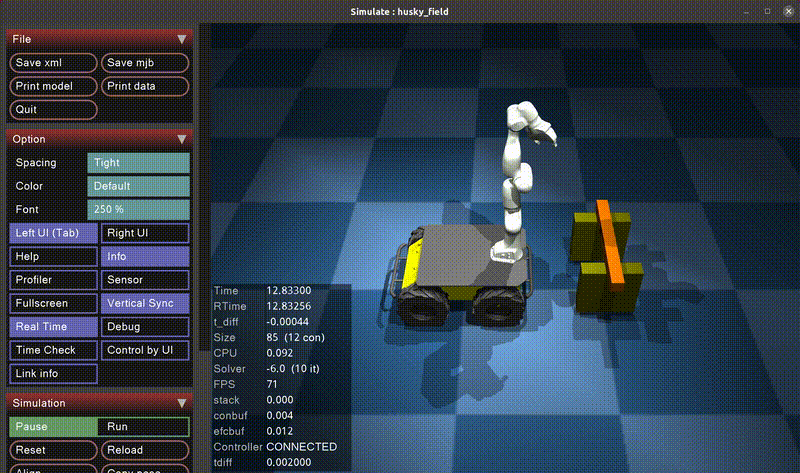

# icir_phri_panda_husky

**Object-aware impedance control for human–robot collaborative transportation using a whole-body mobile manipulator.**

This repository implements a pHRI (physical Human-Robot Interaction) system for human–robot collaborative transportation using a mobile manipulator (Franka Emika Panda + Clearpath Husky). The whole-body motion of the arm and mobile base is coordinated via a QP-based controller. For the interaction itself, we implement **object-aware impedance control**: the mass, center of mass, and inertia of an unknown object held by the robot are estimated online via EKF and incorporated into the impedance controller in real time, enabling more natural and stable collaboration.

## Demo

[](https://www.youtube.com/watch?v=vO1qul85VN0)

---

## Paper

If you use this code, please cite:

```bibtex
@article{park2024object,
  title     = {Object-aware impedance control for human--robot collaborative task with online object parameter estimation},
  author    = {Park, Jinseong and Shin, Yong-Sik and Kim, Sanghyun},
  journal   = {IEEE Transactions on Automation Science and Engineering},
  year      = {2024},
  month     = {October},
  doi       = {10.1109/TASE.2024.3477471}
}
```

---

## System Overview

```
┌─────────────────────────────────────────────────────┐
│                 icir_phri_panda_husky               │
│                                                     │
│   Keyboard / CLI / Joystick                         │
│          ↓                                          │
│   Control Mode Manager                              │
│          ↓                                          │
│   ┌───────────────┐    ┌──────────────────────────┐ │
│   │ HQP Controller│    │  Object Estimation (EKF) │ │
│   │ (icir_hqp)    │◄───│  (icir_object_estimation)│ │
│   └──────┬────────┘    └──────────────────────────┘ │
│          ↓                                          │
│   ┌──────┴───────┐                                  │
│   │  Panda Arm   │   Franka Hardware Interface      │
│   │  Husky Base  │   Husky ROS Driver               │
│   └──────────────┘                                  │
└─────────────────────────────────────────────────────┘
```

### Key Features

- **Whole-body control**: Unified control of Panda arm + Husky mobile base via HQP
- **Object-aware impedance control**: Impedance control that compensates for unknown object dynamics during collaborative transportation
- **Online object parameter estimation**: Real-time estimation of object mass, center of mass, and inertia tensor via EKF
- **Real robot integration**: Franka Panda 1kHz torque control via FCI, Clearpath Husky velocity control via admittance interface (50Hz)
- **MuJoCo simulation**: Full simulation support before real robot deployment

---

## Hardware

| Component | Model | Interface |
|-----------|-------|-----------|
| Robot Arm | Franka Emika Panda | FCI (1kHz) |
| Mobile Base | Clearpath Husky | ROS (50Hz) |
| Gripper | Robotiq 2F-85 | Modbus RTU |

---

## Package Structure

```
icir_phri_ros2_ws/src/
├── icir_phri_panda_husky/       # Main controller (this repo)
│   ├── src/
│   │   ├── phri_simul.cpp       # Simulation controller node
│   │   ├── phri_real.cpp        # Real robot controller plugin (not ported yet)
│   │   └── panda_husky_hqp.cpp  # Whole-body QP controller: task & trajectory management
│   └── python/
│       ├── ns1_real.py          # CLI for real robot
│       ├── ns1_simulation.py    # CLI for simulation
│       └── obstacle_from_mujoco.py  # auto-loads scene obs_* boxes into the /ns1/obstacles param
├── icir_hqp_controller/         # HQP-based hierarchical controller
├── icir_path_planner/           # Mobile-base motion planner (OMPL + steering functions)
│   ├── icir_path_planner/               # Core planning library
│   └── icir_path_planner_ros_interface/ # ROS service server/client wrapper
├── icir_object_estimation/      # EKF-based object parameter estimator
├── icir_trajectory_smoother/    # Time-optimal trajectory generation
├── icir_qpoases/                # qpOASES solver wrapper
├── icir_phri_msgs/              # Custom ROS messages
├── icir_robots_description/     # Robot URDF/mesh descriptions
│   ├── icir_panda_description/
│   ├── icir_panda_husky_description/
│   └── icir_robotiq_2f_85_description/
├── mujoco_ros2_control/         # MuJoCo simulation backend (branch icir_phri_panda_husky_ros2)
└── mujoco_vendor/               # Builds MuJoCo from source
```

The directory names above are the package names; the repositories they come from carry the
`_ros2` suffix (see [2. Installation](#2-installation)).

Not part of this workspace yet — still ROS 1 only: `franka_ros`, `husky`, `icir_robotiq`
(real robot drivers), `icir_phri_viz` (Rviz visualization) and `icir_mujoco_ros`
(the ROS 1 MuJoCo bridge, replaced by `mujoco_ros2_control`).

---

## 1. System Requirements

| | Robot PC | User PC |
|---|---|---|
| **OS** | Ubuntu 22.04 | Ubuntu 22.04 |
| **ROS** | Humble | Humble |

> This is the ROS 2 Humble port. The ROS 1 (Melodic/Noetic) version lives in the original
> repositories without the `_ros2` suffix.

### External Libraries (Robot PC)

| Library | Version | Install |
|---------|---------|---------|
| pinocchio | — | See [official guide](https://stack-of-tasks.github.io/pinocchio/download.html) |
| eigen3 | — | `sudo apt install libeigen3-dev` |
| eiquadprog | — | `sudo apt install ros-humble-eiquadprog` |
| libfranka | v0.9.0 | See [compatibility guide](https://frankarobotics.github.io/docs/compatibility.html) |
| franka_ros | v0.8.1 | — |
| Franka robot system | v4.2.1 | — |

### MuJoCo (Simulation only)

No manual install and no license key. `mujoco_vendor` builds MuJoCo from source as part of
`colcon build`. The ROS 1 bridge `icir_mujoco_ros` and its bundled `mjpro200` SDK are no
longer used — `mujoco_ros2_control` replaces them.

---

## 2. Installation

Clone all packages into your colcon workspace `src/` folder.

```bash
mkdir -p ~/icir_phri_ros2_ws/src
cd ~/icir_phri_ros2_ws/src
```

### Controller & Algorithm
```bash
git clone https://github.com/iCIRLab/icir_qpoases_ros2.git
git clone https://github.com/iCIRLab/icir_hqp_controller_ros2.git
git clone https://github.com/iCIRLab/icir_trajectory_smoother_ros2.git
git clone https://github.com/iCIRLab/icir_path_planner_ros2.git
```

### Robot Model & Simulator
```bash
git clone https://github.com/iCIRLab/icir_robots_description_ros2.git
git clone https://github.com/iCIRLab/mujoco_vendor.git
git clone -b icir_phri_panda_husky_ros2 https://github.com/iCIRLab/mujoco_ros2_control.git
```

> `mujoco_ros2_control` **must** be cloned from the `icir_phri_panda_husky_ros2` branch.
> The `iCIR_custom` branch is pinned by `icir_tutorial_pinocchio_ros2`, and the two branches
> ship incompatible versions of `MujocoRosInterfacePlugin` — the topic names, the QoS profile,
> and the contents of `joint_states` all differ. Mixing them fails silently: the topics simply
> never match and no data arrives.

### Object Estimation & Messages
```bash
git clone https://github.com/iCIRLab/icir_object_estimation_ros2.git
git clone https://github.com/iCIRLab/icir_phri_msgs_ros2.git
```

### pHRI Task
```bash
git clone https://github.com/iCIRLab/icir_phri_panda_husky_ros2.git
```

### Build
```bash
cd ~/icir_phri_ros2_ws
rosdep install --from-paths src --ignore-src -r -y
colcon build --symlink-install
source install/setup.bash
```

> **Real robot drivers are not ported yet.** `franka_ros`, `husky`, `icir_robotiq` and
> `icir_phri_viz` are still ROS 1 only, so sections 3 and 4.2 below describe the ROS 1 setup
> and do not apply to this workspace. Simulation (section 4.1) is the supported path.

---

## 3. Setup

> Sections 3.1–3.3 cover the real robot and are still ROS 1. Simulation needs none of them.


### 3.1 Network Setup

```
[User PC]          ──LAN──  [Main Router]  ══WiFi══  [Slave Router]
(ex.192.168.10.10)          (ex.192.168.10.1)              |           \
                                                          LAN           LAN
                                                            |             |
                                                       [Robot PC]      [Panda]
                                                  (ex.192.168.10.51) (ex.192.168.10.52)
                                                            |
                                                          Serial
                                                            |
                                                         [Husky]
```

### ~/.bashrc — Robot PC

```bash
export ROS_MASTER_URI=http://192.168.10.10:11311  # ex. User PC IP (ROS Master)
export ROS_IP=192.168.10.51                       # ex. Robot PC IP
source /opt/ros/melodic/setup.bash
source ~/icir_phri_ws/devel/setup.bash
```

### ~/.bashrc — User PC

```bash
export ROS_MASTER_URI=http://192.168.10.10:11311  # ex. User PC IP (ROS Master)
export ROS_IP=192.168.10.10                       # ex. User PC IP
source /opt/ros/noetic/setup.bash
source ~/icir_phri_ws/devel/setup.bash
```

> `ROS_MASTER_URI` must always point to the User PC's IP.

---

### 3.2 Husky Auto-start Service

Registers a systemd service so that `husky_base base.launch` starts automatically when the Robot PC boots. Run the following on the **Robot PC**.

### 1) Create `auto_start.sh`

```bash
gedit $HOME/auto_start.sh
```

Enter the following and save:

```bash
#!/bin/bash
source /opt/ros/melodic/setup.bash
source $HOME/icir_phri_ws/devel/setup.bash

export ROS_HOSTNAME=192.168.10.51
export ROS_MASTER_URI=http://192.168.10.51:11311

roslaunch husky_base base.launch
```

Grant execute permission:

```bash
chmod +x $HOME/auto_start.sh
```

> **Note**: At boot time, the network connection to the User PC is not yet established, so the Robot PC is set as its own ROS master to start independently. During experiments, stop the service first and restart it as described in [Step 1](#step-1--stop-auto-start-service).

### 2) Create `cnu.service`

```bash
sudo gedit /etc/systemd/system/cnu.service
```

Enter the following and save. Update the `ExecStart` path with your actual username:

```ini
[Unit]
Description="bringup husky at CNU"
After=network-online.target
Wants=network-online.target

[Service]
Type=simple
ExecStart=/home/<username>/auto_start.sh
Restart=always
RestartSec=3

[Install]
WantedBy=multi-user.target
```

### 3) Enable and start the service

```bash
sudo systemctl daemon-reload
sudo systemctl enable cnu.service
sudo systemctl start cnu.service
```

### 3.3 End-Effector Setup

Register the Robotiq gripper end-effector parameters in Franka Desk.

1. Open Franka Desk (`192.168.10.52`)
2. Go to **Settings → End-Effector**
3. Upload `icir_robotiq/config/endeffector-config.json`

```json
{"mass":0.9,"centerOfMass":[0,0,0.057],"transformation":[1,0,0,0,0,1,0,0,0,0,1,0,0,0,0,1],"inertia":[0.002768,0,0,0,0.003149,0,0,0,0.000564]}
```

---

## 4. Usage

### 4.1 Simulation



There are two simulation scenes, each with its own launch file and MuJoCo world:

**A. pHRI / manipulation scene** — object-aware impedance control, estimation, jog, etc.

```bash
ros2 launch icir_phri_panda_husky ns1_phri_simulation_w_viz.launch.py
```

**B. Path-planning scene** — mobile-base navigation around obstacles (keys `6` / `7`).
This launch additionally **auto-starts the path-planner server** and **auto-loads the
scene's obstacles**, so nothing else is needed:

```bash
ros2 launch icir_phri_panda_husky ns1_path_simulation_w_viz.launch.py
```

In a separate terminal, launch the CLI (optional, either scene):

```bash
ros2 run icir_phri_panda_husky ns1_simulation.py
```

> **Scenes are independent.** The path-planner server and obstacle loading are wired only
> into scene **B**. If you trigger a path mode (`6`/`7`) in scene **A**, the planner is not
> running and no obstacles are defined — use scene **B** for navigation. See
> [Obstacles](#obstacles) for how a scene's obstacles are defined.

---

### 4.2 Real Robot

> **ROS 1 only.** The real-robot path is not ported yet: `franka_ros`, `husky` and
> `icir_robotiq` have no ROS 2 build, and `src/phri_real.cpp` is still commented out in
> `CMakeLists.txt`. The commands below are kept for reference and describe the ROS 1 setup.


> Before running, unlock the robot and activate FCI in Panda Desk (`192.168.10.52`).

Commands that run on the Robot PC are executed via SSH from the User PC in separate terminals.

```bash
ssh <username>@<ROBOT_PC_IP>  # ex. ssh icir@192.168.10.51
```

### Step 1 — Stop auto-start service

On boot, `cnu.service` starts automatically and sets the Robot PC as its own ROS master. Stop the service before using the User PC as master.

Robot PC (SSH):

```bash
./stop_service.sh
```

<details><summary>Script contents</summary>

`stop_service.sh`
```bash
sudo systemctl stop cnu.service
```

</details>

> See [3.2 Husky Auto-start Service](#32-husky-auto-start-service) for service configuration.

### Step 2 — roscore

User PC (ROS master):

```bash
roscore
```

### Step 3 — Husky base driver

Robot PC (SSH):

```bash
./run_husky.sh
```

<details><summary>Script contents</summary>

`run_husky.sh`
```bash
roslaunch husky_base base.launch
```

</details>

### Step 4 — Robotiq gripper action server

Robot PC (SSH):

```bash
./run_robotiq_gripper.sh
```

<details><summary>Script contents</summary>

`run_robotiq_gripper.sh`
```bash
sudo chmod 777 /dev/ttyUSB1
roslaunch robotiq_2f_gripper_control robotiq_action_server_ns1.launch
```

</details>

### Step 5 — Main controller

Robot PC (SSH):

```bash
./run_controller.sh
```

<details><summary>Script contents</summary>

`run_controller.sh`
```bash
roslaunch icir_phri_panda_husky ns1_phri_real_2f85.launch mobile:=true
```

</details>

### Step 6 — Visualization on User PC (Optional)

User PC:

```bash
roslaunch icir_phri_viz ns1_phri_viz.launch
```

### Step 7 — CLI (Optional)

User PC:

```bash
rosrun icir_phri_panda_husky ns1_real.py
```

---

## 5. Control Modes

Available CLI commands (via `ns1_simulation.py`, or the same key in the MuJoCo viewer).
Modes are grouped by simulation scene; a few utilities work in **both**.

### Common (both scenes)

| CLI Command | Key | Description |
|-------------|-----|-------------|
| `gravity` | `g` | Gravity compensation mode |
| `home` | `h` | Move to home position |
| `hold` | `f` | Hold current position |
| `grasp` | `z` | Toggle gripper |
| `print_ee` | `p` | Print current EE state |
| `ee_pz` / `ee_nz` | `i` / `k` | EE jog ±0.1m along z |
| `ee_px` / `ee_nx` | `l` / `j` | EE jog ±0.1m along x |
| `ee_py` / `ee_ny` | `u` / `o` | EE jog ±0.1m along y |
| `mobile_px` / `mobile_nx` | `a` / `s` | Mobile jog ±1.5m along x |

---

### A. pHRI scene

Object-aware impedance control, interaction, and online object estimation.
Run with `ns1_phri_simulation_w_viz.launch`.

#### Control

| CLI Command | Key | Description |
|-------------|-----|-------------|
| `admittance` | `c` | Admittance control for pHRI |
| `impedance` | `v` | Impedance control for pHRI |
| `impedance_k` | `n` | Impedance control with nonzero stiffness |
| `fext` | `b` | Toggle external force application |
| `fext_mobile` | `m` | Toggle mobile teaching |

#### Object Estimation

| CLI Command | Key | Description |
|-------------|-----|-------------|
| `est_arm` | `w` | Identification motion (arm only) |
| `est_mobile` | `e` | Identification motion (with mobile) |
| `estimation` | `q` | Start object parameter estimation |
| `obj_dynamics` | `x` | Toggle object dynamics compensation |

#### Whole-body Motion

| CLI Command | Key | Description |
|-------------|-----|-------------|
| `wb_global` | `1` | Whole-body delta motion in global frame |
| `wb_local` | `2` | Whole-body delta motion in local frame |
| `chicken_p` | `3` | Chicken head motion +mobile |
| `chicken_n` | `4` | Chicken head motion -mobile |
| `mobile_back` | `5` | Mobile base backward 5sec, maintain posture |

---

### B. Path-planning scene

Mobile-base navigation to a target pose, with obstacle avoidance.
Run with `ns1_path_simulation_w_viz.launch` (auto-starts the planner server + obstacle loader).

> Modes `6` / `7` use the planner (scene **B**). Mode `8` needs no planner and also runs in scene **A**.

| CLI Command | Key | Description |
|-------------|-----|-------------|
| `path_se3` | `6` | Path-planner mobile motion **+ EE SE3 maintenance** (arm holds object pose) |
| `path_mobile` | `7` | Path-planner **mobile-only** motion + joint-posture maintenance |
| `wb_longrange` | `8` | Long-range whole-body SE3 move (no planner) |

#### SE3-only vs. Path planner

These three modes cover the different ways to move the mobile base, and the choice
depends on the **nonholonomic (differential-drive) constraint** of the Husky 

| Mode | Key | Base heading (θ) | EE during travel | Planner? | When to use |
|------|-----|------------------|------------------|----------|-------------|
| `path_se3` | `6` | **constrained** to the planned path | held fixed in global (SE3 maintained) | **Yes** | Object must stay still in the world while the base travels a long/curved route — the arm alone can't reach that far, so the planner gives a feasible base path. |
| `path_mobile` | `7` | **constrained** to a specific final θ | not maintained (posture hold only) | **Yes** | The base must end at an exact orientation/pose. |
| `wb_longrange`| `8` | **free** — solver rotates base as needed | EE target is the *goal* being pulled to | **No** | Final base heading doesn't matter, no obstacles. Works for lateral / long-range targets because the base is free to turn and drive toward the EE. |

**Key idea:** a plain SE3 whole-body move (`8`) is enough whenever the base heading is
*unconstrained* — the whole-body QP freely rotates the base to chase the EE target, so
even lateral and long-range motions succeed. You need the **path planner** (`6` / `7`)
only when one of these is required:

1. the base must finish at a **specific heading/pose** (`7`),
2. the EE SE3 must be **precisely maintained** while the base makes a long/curved
   traversal beyond the arm's reach (`6`), or
3. **obstacle avoidance** is needed (the planner routes around obstacles; a straight
   SE3 pull cannot).

> ⚠️ **Known issue (key `6`): EE-orientation vibration.**
> When maintaining the EE rotation while the base follows the planned path, the arm
> exhibits vibration. Two causes are suspected:
> 1. **Staircase reference** — each waypoint is applied with `setDuration(0.001)`, so the
>    mobile/EE reference jumps instantaneously every 0.1 s instead of interpolating,
>    producing large velocity/acceleration spikes.
> 2. **Base-yaw ↔ EE-orientation conflict** — as the base yaws along the path, the
>    fixed global EE orientation forces the wrist to counter-rotate; `mobileTask_ori_`
>    (weight 0.1) and `eeTask_` (weight 1.0) sit at the *same* priority and fight each
>    other, amplifying orientation errors.
>
> **Not fixed yet.** Planned remedy: densify waypoints (e.g. 1000-point linear
> interpolation) with a continuous per-step reference, and/or separate task priorities
> so base motion lives in the EE-task null space.

Modes `6` and `7` obtain their base path from the separate **`icir_path_planner`**
package. The path-planning launch (scene **B**) starts its service server automatically;
to run the server standalone use `ros2 launch icir_path_planner_ros_interface server.launch.py`.
See that package's
[README](../icir_path_planner/icir_path_planner_ros_interface/README.md) for details.

#### Obstacles

Obstacles are **auto-loaded from the MuJoCo scene** — the XML is the single source of truth,
so no rebuild is needed when they change:

1. In the scene XML, any collision box whose geom `name` starts with **`obs_`** is an
   obstacle (e.g. `obs_pillar1`). Other geoms (the robot, a carried `object`, …) are ignored.
2. At launch, [`obstacle_from_mujoco.py`](python/obstacle_from_mujoco.py) parses the XML,
   converts each `obs_*` box (center `pos` + half-extent `size`) to `[cx, cy, half_x, half_y]`
   in the world frame, and writes the list to the `/<ns>/obstacles` param.
3. The controller reads that param when a path mode starts, adds `/<ns>/obstacle_margin`
   (default `0.15 m`) of extra clearance, and sends the rectangles to the planner.

To add or move an obstacle, just edit the `obs_*` box in the scene XML — the change is
reflected on the next launch. The planner already inflates by the robot footprint, so keep
`obstacle_margin` small (too large a margin can place the start inside an obstacle and the
planner reports *"no valid initial states"*).

---

## 6. Troubleshooting

**ROS nodes cannot see each other**
- Verify both PCs have the same `ROS_MASTER_URI`
- Check network connectivity: `ping <ROBOT_PC_IP>`
- Disable firewall: `sudo ufw disable`

**Franka connection failure**
- Unlock the robot and activate FCI in Panda Desk
- Verify `robot_ip` parameter matches the actual Panda IP

**Controller fails to spawn**
- Check URDF and controller yaml are loaded correctly: `ros2 param list`

---

## License

This project is licensed under the MIT License — see the [LICENSE](LICENSE) file for details.

---

## Contact

**Jinseong Park**  
[iCIR Lab, Chungnam National University](https://sites.google.com/view/icir-lab/)  
js.park@cnu.ac.kr
